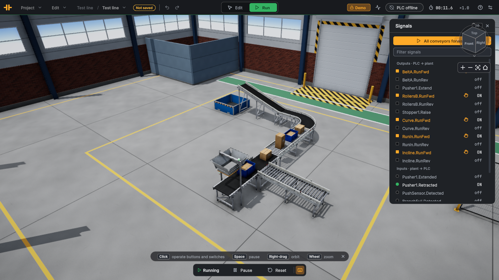
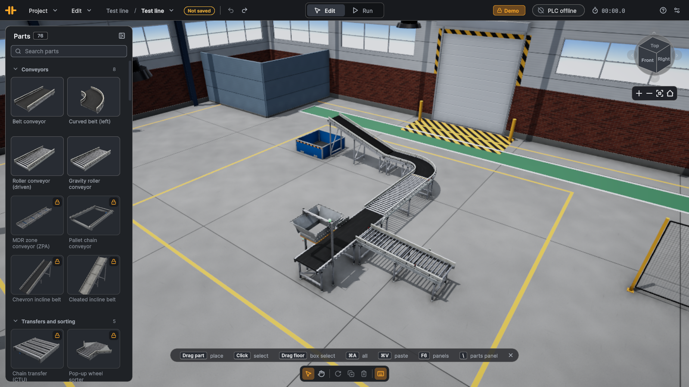
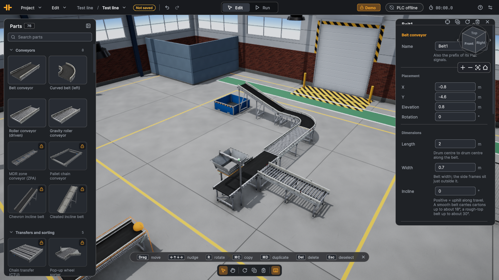
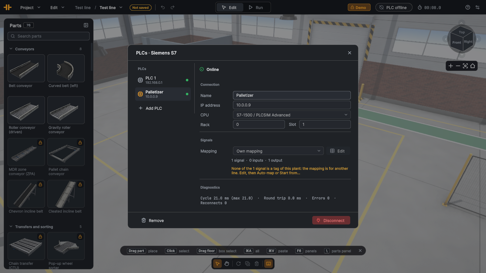
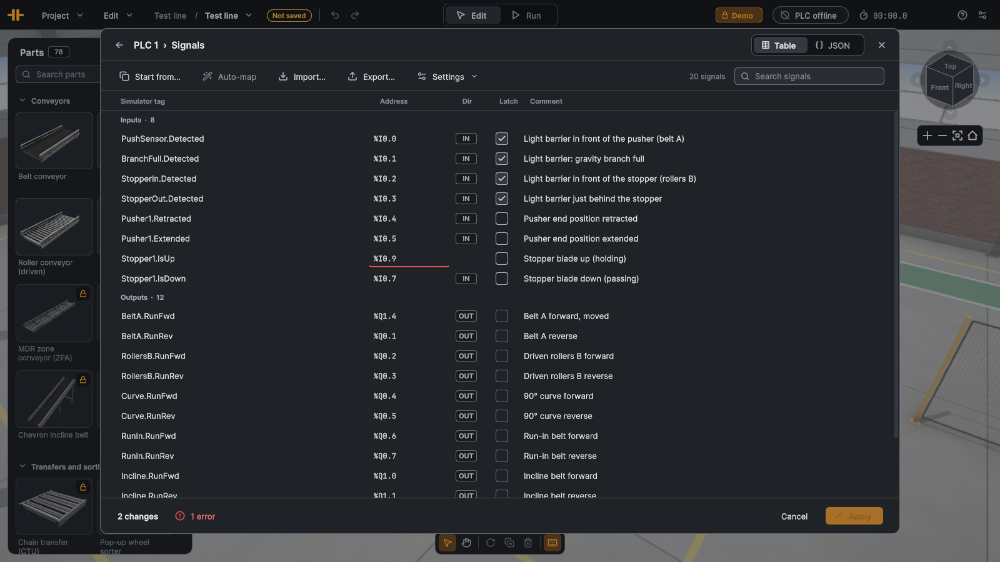

# LineRig

**The easy 3D plant simulator for PLC training.** Describe a line, drop in a drawing or lay it out yourself.
It comes alive in 3D and runs from your own PLC program.

Works with S7-1200 and S7-1500 PLCs over PUT/GET and with S7-PLCSIM Advanced; no PLC at hand, drive the signals
from the built-in panel.

## Download

The free demo and the full version are the same app; a licence key unlocks it.

| | |
|---|---|
| **Windows** 10/11, 64-bit | [LineRig-windows-x64.zip](https://github.com/linerig/linerig/releases/latest/download/LineRig-windows-x64.zip) |
| **macOS** 12 or newer, Apple silicon and Intel | [LineRig-macos.dmg](https://github.com/linerig/linerig/releases/latest/download/LineRig-macos.dmg) |

All versions, release notes and checksums: [Releases](https://github.com/linerig/linerig/releases).
System requirements and first-start notes: [linerig.com/download](https://linerig.com/download/).
Licences: [linerig.com/pricing](https://linerig.com/pricing/).

## Pictures

| | |
|---|---|
|  |  |
|  |  |

## Samples

[`samples/`](samples/) holds the TIA Portal tag tables and exercise sheets for the sample plants that ship
with the app (*File → Open sample…*).

## Questions and bugs

Report a bug or suggest a part in [Issues](https://github.com/linerig/linerig/issues/new/choose). For licences
and orders write to hello@linerig.com.

## Licence

The app is proprietary and used under its [licence agreement](https://linerig.com/legal/eula/); its source
code is not public. The samples and pictures in this repository are licensed under
[CC BY 4.0](LICENSE.md).

All product and company names mentioned are trademarks or registered trademarks of their respective holders.
Their use does not imply any affiliation with or endorsement by them.
