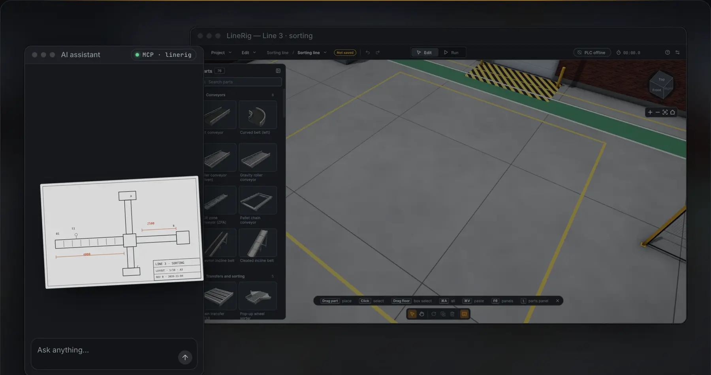
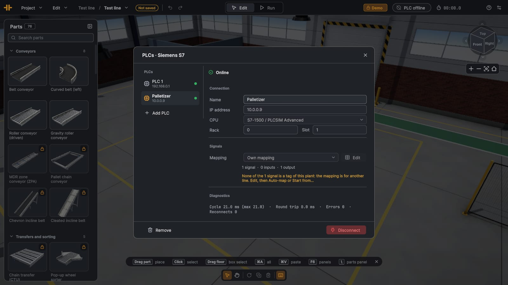
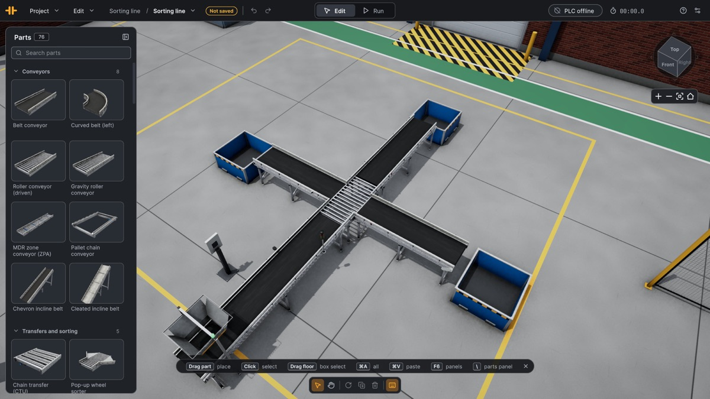
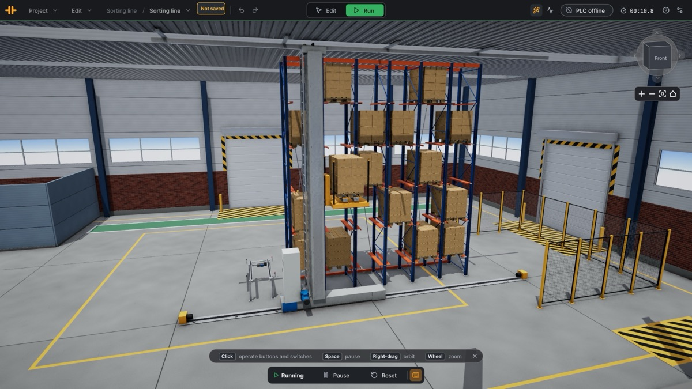
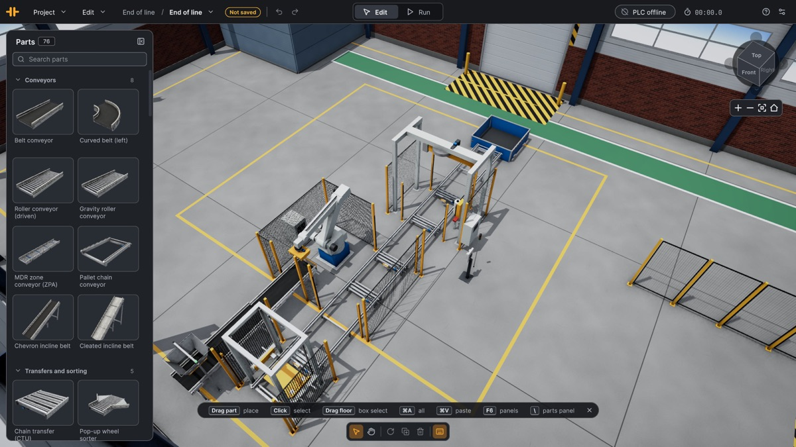

  

<h1 align="center">Where simulation meets the plant.</h1>

<b>Describe a line, drop in a drawing or lay it out yourself. It comes alive in 3D and runs from your own PLC program.</b>

  
  
  

  

## Describe a line. AI builds it.

Talk to your AI assistant. It suggests, builds what you pick and changes it on request. LineRig speaks MCP and
works with the AI subscription you already have.

## Real enough to debug. Simple enough to start.

| | |
|---|---|
| **Physics that feels real** Cartons slip, queue, tip and jam, just like on the floor. | **Every machine a line needs** Conveyors, sorters, robots, palletizers, AS/RS and safety. |
| **Your real PLC** Plug in your PLC or PLCSIM. Real signals, real conventions. | **Edit, Run, Reset** Snap a line together. Press Run. Reset in one click. |

## Add your PLC. Press Connect.

## Complex lines. Made easy.

|  |  |  |
|:---:|:---:|:---:|
| **Sorting line** Scanner, wheel sorter, three lanes. | **High-bay warehouse** Pallet racks and a stacker crane. | **End of line** Robot palletizer to stretch wrapper. |

## Links

- [Website](https://linerig.com) · [Docs](https://linerig.com/docs/) · [Download](https://linerig.com/download/) · [Pricing](https://linerig.com/pricing/)
- [Report a bug or suggest a part](https://github.com/linerig/linerig/issues/new/choose)
