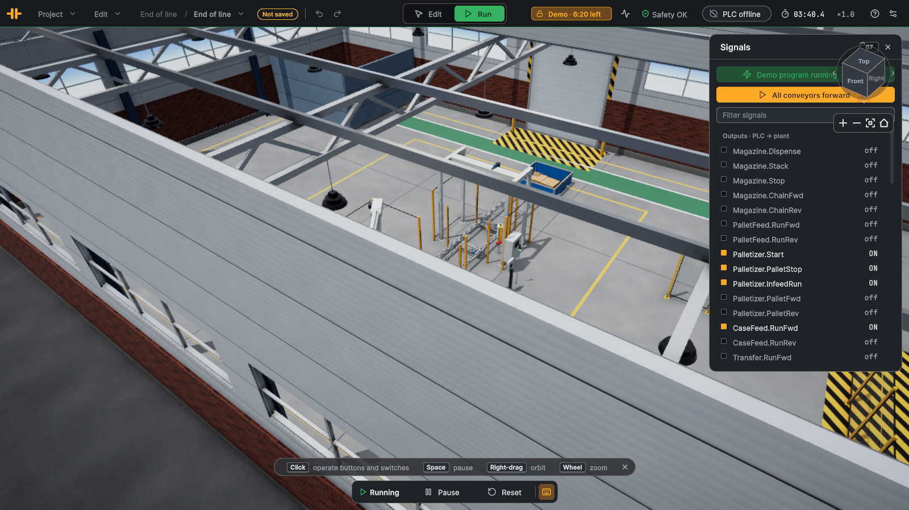

# End of line

Level: expert. Three stations that hand a pallet on: a pallet magazine, a robot palletizer and a stretch wrapper, each with
its own handshake, plus the case belt that feeds the robot.

## The plant

Pallet magazine (6 empty EUR pallets) → pallet feed conveyor → robot palletizer (2 layers × 8 cases) → transfer conveyor →
stretch wrapper → outfeed conveyor → pick-up point. Small cartons come every 2 s on the case belt into the palletizer's
infeed. A control stand with Start, Stop and the E-stop, and a stack light, stand beside the transfer conveyor.

| Device | Part | Handshake |
|---|---|---|
| `Magazine` | pallet magazine | rising edge on `Dispense` → `Busy` → `Done`; then run `ChainFwd` to convey the pallet out |
| `PalletFeed` | pallet chain conveyor | runs while a pallet goes to the palletizer |
| `Palletizer`, `CaseFeed` | robot palletizer, belt | `PalletStop` + `PalletFwd` until `PalletInPos`; `Start` while stacking; `InfeedRun` keeps a case at the end stop; `PalletComplete` when done |
| `Transfer`, `Wrapper` | chain conveyor, stretch wrapper | `PalletStop` + `ChainFwd` until `PalletInPos`; rising edge on `Start`; `Busy` → `Done` with `ArmHome` |
| `Outfeed`, `OutfeedEnd`, `Pickup` | chain conveyor, light barrier, remover | the pallet is taken away at the end |
| `EStop`, `Start`, `Stop`, `Tower` | operator controls | as in the packaging cell |

## Goal

Run the line unattended: always have an empty pallet at the palletizer, take the full pallet to the wrapper as soon as the
wrapper is free, wrap it and send it to the pick-up point; stop and restart cleanly; survive an E-stop in the middle of a
cycle.

## I/O list

**Inputs (plant → PLC)**

| Address | PLC tag | Type | Meaning |
|---|---|---|---|
| `%I0.0` | `Start_Contact` | Bool | Start push button (NO, green, lit) |
| `%I0.1` | `Stop_Contact` | Bool | Stop push button (NC: 0 = pressed) |
| `%I0.2` | `EStop_EStopOk` | Bool | E-stop mushroom not pressed (auxiliary contact) |
| `%I0.3` | `EStop_SafetyOk` | Bool | Safety relay closed: drives may run |
| `%I0.4` | `EStop_ResetPressed` | Bool | Blue reset button pressed |
| `%I0.5` | `Magazine_Empty` | Bool | Pallet magazine empty |
| `%I0.6` | `Magazine_Full` | Bool | Pallet magazine full |
| `%I0.7` | `Magazine_PalletInPos` | Bool | Pallet magazine: pallet on the chain under the stack |
| `%I1.0` | `Magazine_Busy` | Bool | Pallet magazine: cycle running |
| `%I1.1` | `Magazine_Done` | Bool | Pallet magazine: cycle done (holds until the next command) |
| `%I1.2` | `Magazine_Fault` | Bool | Pallet magazine: command refused |
| `%I1.3` | `Magazine_LiftDown` | Bool | Pallet magazine: lift table below the chains |
| `%I1.4` | `Magazine_LiftMid` | Bool | Pallet magazine: lift table at separation height |
| `%I1.5` | `Magazine_LiftUp` | Bool | Pallet magazine: lift table at the holders |
| `%I1.6` | `Magazine_HoldersIn` | Bool | Pallet magazine: holders in the pallet |
| `%I1.7` | `Magazine_HoldersOut` | Bool | Pallet magazine: holders out |
| `%I2.0` | `Palletizer_Ready` | Bool | Palletizer: robot home, no cycle |
| `%I2.1` | `Palletizer_Busy` | Bool | Palletizer: robot in a cycle |
| `%I2.2` | `Palletizer_CaseInPos` | Bool | Palletizer: case at the infeed end stop |
| `%I2.3` | `Palletizer_PalletInPos` | Bool | Palletizer: pallet at the raised stop |
| `%I2.4` | `Palletizer_LayerComplete` | Bool | Palletizer: layer complete |
| `%I2.5` | `Palletizer_PalletComplete` | Bool | Palletizer: pallet complete (until it leaves) |
| `%I2.6` | `Palletizer_Fault` | Bool | Palletizer fault |
| `%I2.7` | `Wrapper_PalletInPos` | Bool | Stretch wrapper: pallet at the raised stop |
| `%I3.0` | `Wrapper_Busy` | Bool | Stretch wrapper: wrapping |
| `%I3.1` | `Wrapper_Done` | Bool | Stretch wrapper: wrapped (until the pallet leaves) |
| `%I3.2` | `Wrapper_ArmHome` | Bool | Stretch wrapper: arm home, carriage down |
| `%I3.3` | `Wrapper_Fault` | Bool | Stretch wrapper fault |
| `%I3.4` | `OutfeedEnd_Detected` | Bool | Photo-eye at the end of the outfeed: pallet ready for pick-up · latched |
| `%I3.5` | `Magazine_ChainMotorOK` | Bool | Pallet magazine chain motor protection OK |
| `%I3.6` | `Transfer_MotorOK` | Bool | Transfer conveyor motor protection OK |
| `%I3.7` | `Outfeed_MotorOK` | Bool | Outfeed conveyor motor protection OK |
| `%I4.0` | `PalletFeed_MotorOK` | Bool | Pallet feed conveyor motor protection OK |
| `%ID8` | `Magazine_StackCount` | DInt | Pallet magazine: pallets in the stack (DINT) |
| `%ID12` | `Palletizer_CaseCount` | DInt | Palletizer: cases on the pallet (DINT) |
| `%ID16` | `Palletizer_LayerCount` | DInt | Palletizer: complete layers (DINT) |
| `%ID20` | `Palletizer_CasesPerLayer` | DInt | Palletizer: cases per layer (DINT) |
| `%ID24` | `Wrapper_Wraps` | DInt | Stretch wrapper: film revolutions (DINT) |
| `%ID28` | `Wrapper_LoadHeight` | DInt | Stretch wrapper: load height, mm (DINT) |

**Outputs (PLC → plant)**

| Address | PLC tag | Type | Meaning |
|---|---|---|---|
| `%Q0.0` | `Magazine_Dispense` | Bool | Pallet magazine: dispense the bottom pallet (rising edge) |
| `%Q0.1` | `Magazine_Stack` | Bool | Pallet magazine: take the pallet into the stack (rising edge) |
| `%Q0.2` | `Magazine_Stop` | Bool | Pallet magazine: raise the end stop |
| `%Q0.3` | `Magazine_ChainFwd` | Bool | Pallet magazine chain forward |
| `%Q0.4` | `PalletFeed_RunFwd` | Bool | Pallet feed conveyor forward |
| `%Q0.5` | `Palletizer_Start` | Bool | Palletizer automatic: stack while on |
| `%Q0.6` | `Palletizer_PalletStop` | Bool | Palletizer: raise the pallet stop |
| `%Q0.7` | `Palletizer_InfeedRun` | Bool | Palletizer case infeed belt |
| `%Q1.0` | `Palletizer_PalletFwd` | Bool | Palletizer pallet chain forward |
| `%Q1.1` | `CaseFeed_RunFwd` | Bool | Case belt forward |
| `%Q1.2` | `Transfer_RunFwd` | Bool | Transfer conveyor forward |
| `%Q1.3` | `Wrapper_Start` | Bool | Stretch wrapper: wrap the pallet (rising edge) |
| `%Q1.4` | `Wrapper_PalletStop` | Bool | Stretch wrapper: raise the stop |
| `%Q1.5` | `Wrapper_ChainFwd` | Bool | Stretch wrapper chain forward |
| `%Q1.6` | `Outfeed_RunFwd` | Bool | Outfeed conveyor forward |
| `%Q1.7` | `Start_Lamp` | Bool | Lamp in the Start button |
| `%Q2.0` | `EStop_ResetLamp` | Bool | Lamp in the reset button: reset needed |
| `%Q2.1` | `Tower_Red` | Bool | Stack light red: safety open / fault |
| `%Q2.2` | `Tower_Yellow` | Bool | Stack light yellow: ready, stopped |
| `%Q2.3` | `Tower_Green` | Bool | Stack light green: running |
| `%Q2.4` | `Tower_Buzzer` | Bool | Stack light buzzer |

Heartbeat word to the PLC: `%IW6` (counts up every exchange).

## Connect the PLC

1. In TIA Portal, import the tag table [EndOfLine_PLCTags.xlsx](EndOfLine_PLCTags.xlsx) (PLC tags ▸ Import) into an S7-1500 (or S7-1200) project and download it
   to PLCSIM Advanced or the CPU. Allow PUT/GET access (Protection & Security ▸ Connection mechanisms).
2. In LineRig, open the sample (File ▸ Open sample…), switch to Run, click the **PLC** pill at the top right, enter the
   CPU's address and connect. The app uses this sample's mapping (`Resources/Plc/EndOfLine.plcmap.json`).
3. While the PLC is connected it owns every output; the demo program is off. Forcing an output in the Signals card still
   overrides the PLC, as in a real CPU.

"Latched" inputs hold a short pulse (a photo-eye interrupted for one 8 ms step) until one exchange has sent it, so a 20 ms
PLC cycle never misses it. Signals are named `<device>.<signal>` in the app and `<device>_<signal>` in TIA Portal.

## Suggested steps

Write one sequence (a CASE on a step number, or GRAPH) per station and let them talk through flags:

1. **Pallet supply.** Station empty (no pallet, not releasing) and `Magazine_Empty` = 0 → rising edge on `Magazine_Dispense`,
   wait for `Magazine_Done`. Then `Magazine_ChainFwd`, `PalletFeed_RunFwd`, `Palletizer_PalletFwd` with
   `Palletizer_PalletStop` raised, until `Palletizer_PalletInPos`.
2. **Palletizing.** `Palletizer_Start` while the pallet is in position. Keep `Palletizer_InfeedRun` on; run `CaseFeed` while
   `Palletizer_CaseInPos` = 0, so cases queue on the belt instead of pushing into the robot's pick.
3. **Hand-over.** On `Palletizer_PalletComplete`, switch Start off and wait for `Palletizer_Ready` (robot home) **and** a free
   wrapper. Lower the palletizer's stop and run its chain, the transfer and the wrapper chain until `Wrapper_PalletInPos`.
   Careful: `Palletizer_PalletInPos` drops the moment the stop is lowered, and `PalletComplete` when the pallet leaves the
   station, half still on the chain. Keep the chains running until the wrapper has the pallet.
4. **Wrapping.** Rising edge on `Wrapper_Start`, wait for `Wrapper_Busy` and then `Wrapper_Done` with `Wrapper_ArmHome`.
5. **Release.** Lower the wrapper's stop, run its chain and the outfeed until `OutfeedEnd_Detected`; then the wrapper is
   free for the next pallet.
6. Safety and start/stop as in the packaging cell. An E-stop in the middle of a robot move: the robot finishes nothing;
   after reset and Start, continue each sequence from its step.

## Expected behaviour

After Run and a reset, the first empty pallet reaches the palletizer within ~15 s, the robot stacks 16 cases in two layers
in about two minutes, the wrapper wraps the full pallet in film, and it leaves on the outfeed into the pick-up point. The
next pallet is already being stacked while the first one is wrapped.

## Without a PLC

A **demo program** runs the line with the sequences above. It starts the line the first time the relay closes, so after Run
you only click the blue reset on the E-stop station. Stop it in the Signals card to force outputs by hand; it switches off
while a PLC is connected.
