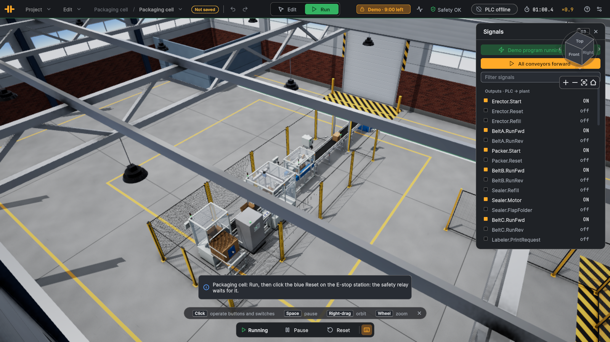

# Packaging cell

Level: advanced. Machine handshakes, a timed kicker, a print-and-apply sequence and a safety circuit with a light curtain and an E-stop.

## The plant

Inside a safety fence: case erector → belt A → case packer (products from a product infeed) → belt B → case sealer → belt C
with a labeler and a check scanner → exit belt, out through an opening in the front fence to the pick-up bin. The opening is
guarded by a light curtain from 1.25 m up: the sealed cases pass under it, an arm reaching in over the belt does not.
Outside the fence, a control stand carries Start, Stop and the E-stop with its blue reset button.

| Device | Part | Notes |
|---|---|---|
| `Erector` | case erector | automatic while `Start`; a case every 8 s; `MagazineLow` / `Refill` / `Fault` / `Reset` |
| `Packer`, `Products` | case packer (2 × 2, 4 products per case), product infeed | automatic while `Start`; releases a full case by itself |
| `Sealer` | case sealer | PLC-controlled: `Motor`, and the rear-flap kicker `FlapFolder` |
| `LabelPos`, `Labeler`, `Scanner` | light barrier, print-and-apply labeler, barcode reader | the scanner reads the applied label |
| `BeltA`, `BeltB`, `BeltC`, `Exit` | belts, 0.5 m wide | `ExitEnd` at the end of the exit belt |
| `Curtain`, `EStop` | light curtain, E-stop with safety relay | both in safety zone 1: either one stops every drive (safe torque off) |
| `Start`, `Stop`, `Tower` | buttons, stack light | |

## Goal

Make sealed, labeled cases with four products each, start and stop the cell cleanly, and handle the safety circuit:
after an E-stop or a broken curtain the cell stays off until the operator resets the relay **and** presses Start.

## I/O list

**Inputs (plant → PLC)**

| Address | PLC tag | Type | Meaning |
|---|---|---|---|
| `%I0.0` | `Start_Contact` | Bool | Start push button (NO, green, lit) |
| `%I0.1` | `Stop_Contact` | Bool | Stop push button (NC: 0 = pressed) |
| `%I0.2` | `EStop_EStopOk` | Bool | E-stop mushroom not pressed (auxiliary contact) |
| `%I0.3` | `EStop_SafetyOk` | Bool | Safety relay closed: drives may run |
| `%I0.4` | `EStop_ResetPressed` | Bool | Blue reset button pressed |
| `%I0.5` | `Curtain_Ossd1` | Bool | Light curtain OSSD 1: field clear |
| `%I0.6` | `Curtain_Ossd2` | Bool | Light curtain OSSD 2: field clear |
| `%I0.7` | `Erector_Ready` | Bool | Case erector: no fault, blanks in the magazine |
| `%I1.0` | `Erector_Running` | Bool | Case erector running |
| `%I1.1` | `Erector_MagazineLow` | Bool | Case erector: few blanks left |
| `%I1.2` | `Erector_Fault` | Bool | Case erector fault (empty magazine) |
| `%I1.3` | `Packer_Ready` | Bool | Case packer: no fault |
| `%I1.4` | `Packer_CartonPresent` | Bool | Case packer: open case in the station |
| `%I1.5` | `Packer_ProductPresent` | Bool | Case packer: product at the pick point |
| `%I1.6` | `Packer_CaseFull` | Bool | Case packer: case in the station is full |
| `%I1.7` | `Packer_Fault` | Bool | Case packer fault (wrong load in the station) |
| `%I2.0` | `Sealer_TapePresent` | Bool | Case sealer: tape for at least one case |
| `%I2.1` | `Sealer_CaseIn` | Bool | Case sealer photo-eye at the rear-flap kicker · latched |
| `%I2.2` | `Sealer_CaseOut` | Bool | Case sealer photo-eye at the discharge · latched |
| `%I2.3` | `Sealer_FolderExtended` | Bool | Case sealer: kicker down |
| `%I2.4` | `LabelPos_Detected` | Bool | Photo-eye: case in front of the labeler · latched |
| `%I2.5` | `Labeler_LabelReady` | Bool | Labeler: label printed, on the pad |
| `%I2.6` | `Labeler_Busy` | Bool | Labeler printing or applying |
| `%I2.7` | `Labeler_Done` | Bool | Labeler: label applied |
| `%I3.0` | `Labeler_PadHome` | Bool | Labeler: pad retracted |
| `%I3.1` | `Labeler_Fault` | Bool | Labeler fault (apply without label, no case) |
| `%I3.2` | `Scanner_NewRead` | Bool | Check scanner: new code (pulse) · latched |
| `%I3.3` | `Scanner_NoRead` | Bool | Check scanner: case passed without a read · latched |
| `%I3.4` | `ExitEnd_Detected` | Bool | Photo-eye at the end of the exit belt · latched |
| `%I3.5` | `Packer_Picked` | Bool | Case packer: head holds a product |
| `%I3.6` | `Packer_Placed` | Bool | Case packer: product placed (0.2 s pulse) · latched |
| `%ID6` | `Erector_Count` | DInt | Case erector: cases erected (DINT) |
| `%ID10` | `Packer_CaseCount` | DInt | Case packer: cases filled (DINT) |
| `%IW14` | `Packer_Count` | Int | Case packer: products in the case in the station |
| `%ID16` | `Sealer_Count` | DInt | Case sealer: cases sealed (DINT) |
| `%ID20` | `Labeler_LastLabel` | DInt | Labeler: code of the last applied label (DINT) |
| `%ID24` | `Scanner_Id` | DInt | Check scanner: last code (DINT) |
| `%IW28` | `Scanner_ReadCount` | Int | Check scanner: good reads |

**Outputs (PLC → plant)**

| Address | PLC tag | Type | Meaning |
|---|---|---|---|
| `%Q0.0` | `Erector_Start` | Bool | Case erector automatic |
| `%Q0.1` | `Erector_Reset` | Bool | Case erector: reset fault (rising edge) |
| `%Q0.2` | `Erector_Refill` | Bool | Operator refills the blank magazine (rising edge) |
| `%Q0.3` | `Packer_Start` | Bool | Case packer automatic |
| `%Q0.4` | `Packer_Reset` | Bool | Case packer: reset fault, release a wrong load (rising edge) |
| `%Q0.5` | `Sealer_Motor` | Bool | Case sealer side belts |
| `%Q0.6` | `Sealer_FlapFolder` | Bool | Case sealer rear-flap kicker |
| `%Q0.7` | `Sealer_Refill` | Bool | Operator puts in a new tape roll (rising edge) |
| `%Q1.0` | `BeltA_RunFwd` | Bool | Belt erector → packer forward |
| `%Q1.1` | `BeltB_RunFwd` | Bool | Belt packer → sealer forward |
| `%Q1.2` | `BeltC_RunFwd` | Bool | Labeling belt forward |
| `%Q1.3` | `Exit_RunFwd` | Bool | Exit belt forward |
| `%Q1.4` | `Labeler_PrintRequest` | Bool | Labeler: print LabelData (rising edge) |
| `%Q1.5` | `Labeler_Apply` | Bool | Labeler: apply the label (rising edge) |
| `%Q1.6` | `Start_Lamp` | Bool | Lamp in the Start button |
| `%Q1.7` | `EStop_ResetLamp` | Bool | Lamp in the reset button: reset needed |
| `%Q2.0` | `Tower_Red` | Bool | Stack light red: safety open / fault |
| `%Q2.1` | `Tower_Yellow` | Bool | Stack light yellow: ready, stopped |
| `%Q2.2` | `Tower_Green` | Bool | Stack light green: running |
| `%Q2.3` | `Tower_Buzzer` | Bool | Stack light buzzer |
| `%QD4` | `Labeler_LabelData` | DInt | Labeler: serial number printed on the next label (DINT) |

Heartbeat word to the PLC: `%IW4` (counts up every exchange).

## Connect the PLC

1. In TIA Portal, import the tag table [PackagingCell_PLCTags.xlsx](PackagingCell_PLCTags.xlsx) (PLC tags ▸ Import) into an S7-1500 (or S7-1200) project and download it
   to PLCSIM Advanced or the CPU. Allow PUT/GET access (Protection & Security ▸ Connection mechanisms).
2. In LineRig, open the sample (File ▸ Open sample…), switch to Run, click the **PLC** pill at the top right, enter the
   CPU's address and connect. The app uses this sample's mapping (`Resources/Plc/PackagingCell.plcmap.json`).
3. While the PLC is connected it owns every output; the demo program is off. Forcing an output in the Signals card still
   overrides the PLC, as in a real CPU.

"Latched" inputs hold a short pulse (a photo-eye interrupted for one 8 ms step) until one exchange has sent it, so a 20 ms
PLC cycle never misses it. Signals are named `<device>.<signal>` in the app and `<device>_<signal>` in TIA Portal.

## Suggested steps

1. Safety: `EStop_SafetyOk` is the relay's feedback. While it is 0, drop every run command (the relay's safe torque off
   does not change your outputs; a drive still commanded runs again after the reset). Light `EStop_ResetLamp` while a reset
   is due (`EStopOk` and both OSSDs are 1 but `SafetyOk` is 0).
2. Start/stop: Start sets `#Running` only with `SafetyOk`; Stop (NC) or a lost `SafetyOk` resets it.
3. While running: `Erector_Start`, `Packer_Start`, `Sealer_Motor`, `BeltA`, `BeltB`, `Exit`.
4. Sealer kicker: on the falling edge of `Sealer_CaseIn` pulse `Sealer_FlapFolder` for 250 ms (R_TRIG + TP). Too early or too
   late and the rear flap stays up: the case leaves "closed", not "sealed".
5. Labeling: print ahead (`Labeler_LabelData` = a serial number, rising edge on `Labeler_PrintRequest`, wait for
   `Labeler_LabelReady`). When `LabelPos_Detected` sees a case, stop belt C, wait 0.3 s, pulse `Labeler_Apply`, wait for
   `Labeler_Done`, restart belt C, increment the serial and print the next label.
6. Check: compare `Scanner_Id` with the serial you applied; count good and bad labels.
7. Operator calls: yellow light when `Erector_MagazineLow` or not `Sealer_TapePresent`; red on any `Fault`.

## Expected behaviour

After Run, click the blue reset on the E-stop station: the relay closes and the cell starts. The erector makes a case every
8 s, the packer fills it with four products, the sealer folds and tapes it, the labeler stops it briefly and applies a
label, and the case drops into the pick-up bin. Hitting the E-stop or holding the mouse on the light curtain (a test rod in
the field) stops every drive; it stays stopped after the release until reset and Start.

## Without a PLC

A **demo program** runs the cell with the logic above. It starts the cell the first time the relay closes, so after Run you
only click the blue reset. Stop it in the Signals card to force outputs by hand; it switches off while a PLC is connected.
