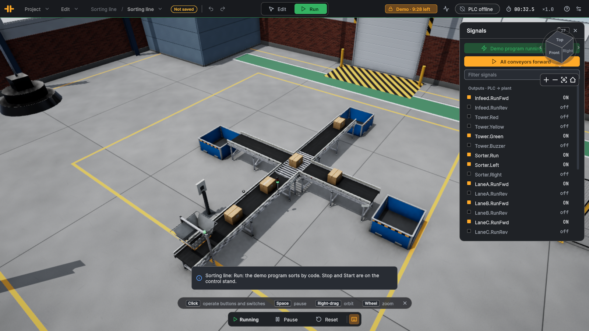

# Sorting line

Level: intermediate. Track cartons from a barcode reader to a pop-up wheel sorter and divide them into three lanes.

## The plant

| Device | Part | What it does |
|---|---|---|
| `Emitter1` | emitter | a small carton (400 × 300 mm) every 3 s on the infeed belt |
| `Infeed` | belt conveyor, 4 m | carries the cartons past the reader to the sorter |
| `Reader` | barcode reader | reads each carton's code once (`Id`, `ReadCount` +1, `NewRead` pulse; `NoRead` when a carton passed unread) |
| `Sorter` | pop-up wheel sorter, right-angle outlets | rollers straight on; `Left` / `Right` steer the wheels and lift them: the carton leaves square to the line |
| `LaneA`, `LaneB`, `LaneC` | belt conveyors | left lane, straight lane, right lane, each into a bin |
| `LaneAIn`, `LaneBIn`, `LaneCIn` | light barriers | divert confirmation, 0.5 m into each lane |
| `BinA`, `BinB`, `BinC` | removers | count the cartons of each lane |
| `Panel` with `Start`, `Stop`, `Mode` | control stand | Start (lit, NO), Stop (NC), a two-position Mode switch |
| `Tower` | stack light | red, yellow, green, buzzer |

## Goal

Sort by code: code mod 3 = 0 to lane A (left), 1 to lane B (straight on), 2 to lane C (right). A no-read goes straight on.
With the Mode switch at I, every carton goes straight on. The line runs between Start and Stop.

## I/O list

**Inputs (plant → PLC)**

| Address | PLC tag | Type | Meaning |
|---|---|---|---|
| `%I0.0` | `Start_Contact` | Bool | Start push button (NO, green, lit) |
| `%I0.1` | `Stop_Contact` | Bool | Stop push button (NC: 0 = pressed) |
| `%I0.2` | `Mode_Pos1` | Bool | Mode switch at I: everything straight on to lane B |
| `%I0.3` | `Reader_NewRead` | Bool | Barcode reader: new code (200 ms pulse) · latched |
| `%I0.4` | `Reader_NoRead` | Bool | Barcode reader: carton passed without a read · latched |
| `%I0.5` | `Sorter_Detected` | Bool | Photo-eye at the sorter infeed · latched |
| `%I0.6` | `LaneAIn_Detected` | Bool | Lane A (left) divert confirmation · latched |
| `%I0.7` | `LaneBIn_Detected` | Bool | Lane B (straight) confirmation · latched |
| `%I1.0` | `LaneCIn_Detected` | Bool | Lane C (right) divert confirmation · latched |
| `%IW4` | `Reader_ReadCount` | Int | Barcode reader: good reads (+1 per code) |
| `%ID6` | `Reader_Id` | DInt | Barcode reader: last code (DINT) |

**Outputs (PLC → plant)**

| Address | PLC tag | Type | Meaning |
|---|---|---|---|
| `%Q0.0` | `Infeed_RunFwd` | Bool | Infeed belt forward |
| `%Q0.1` | `Sorter_Run` | Bool | Wheel sorter: rollers and wheels |
| `%Q0.2` | `Sorter_Left` | Bool | Wheel sorter: divert left to lane A |
| `%Q0.3` | `Sorter_Right` | Bool | Wheel sorter: divert right to lane C |
| `%Q0.4` | `LaneA_RunFwd` | Bool | Lane A belt forward |
| `%Q0.5` | `LaneB_RunFwd` | Bool | Lane B belt forward |
| `%Q0.6` | `LaneC_RunFwd` | Bool | Lane C belt forward |
| `%Q0.7` | `Start_Lamp` | Bool | Lamp in the Start button |
| `%Q1.0` | `Tower_Red` | Bool | Stack light red: fault |
| `%Q1.1` | `Tower_Yellow` | Bool | Stack light yellow: stopped / attention |
| `%Q1.2` | `Tower_Green` | Bool | Stack light green: running |
| `%Q1.3` | `Tower_Buzzer` | Bool | Stack light buzzer |

Heartbeat word to the PLC: `%IW2` (counts up every exchange).

## Connect the PLC

1. In TIA Portal, import the tag table [SortingLine_PLCTags.xlsx](SortingLine_PLCTags.xlsx) (PLC tags ▸ Import) into an S7-1500 (or S7-1200) project and download it
   to PLCSIM Advanced or the CPU. Allow PUT/GET access (Protection & Security ▸ Connection mechanisms).
2. In LineRig, open the sample (File ▸ Open sample…), switch to Run, click the **PLC** pill at the top right, enter the
   CPU's address and connect. The app uses this sample's mapping (`Resources/Plc/SortingLine.plcmap.json`).
3. While the PLC is connected it owns every output; the demo program is off. Forcing an output in the Signals card still
   overrides the PLC, as in a real CPU.

"Latched" inputs hold a short pulse (a photo-eye interrupted for one 8 ms step) until one exchange has sent it, so a 20 ms
PLC cycle never misses it. Signals are named `<device>.<signal>` in the app and `<device>_<signal>` in TIA Portal.

## Suggested steps

1. Start/stop latch: `Start_Contact` sets `#Running`, `Stop_Contact` = 0 (NC, pressed or wire broken) resets it. Show it on
   `Start_Lamp`, `Tower_Green`; `Tower_Yellow` while stopped. Run `Infeed`, `Sorter_Run` and the three lanes while running.
2. Tracking: when `Reader_ReadCount` changes, put the lane of `Reader_Id` into a FIFO (an array with a write and a read
   index). Put "straight" into it on a rising edge of `Reader_NoRead` too, so the FIFO stays in step with the cartons.
3. Divert window: on the **falling** edge of `Sorter_Detected` the whole carton is on the module. Take the oldest entry,
   let the rollers carry the carton on for 0.8 s (0.4 m at 0.5 m/s) until it stands in front of the outlets, then switch
   `Sorter_Left` or `Sorter_Right` on for about 1.2 s.
4. Check the confirmations: the lane's `In` light barrier must see the carton within ~2 s, otherwise flag a mis-sort
   (red light, buzzer) and stop.
5. Extension: count cartons per lane and stop a lane's divert when its bin is "full" (a counter limit).

Two classic mistakes: diverting on the rising edge of the photo-eye (the back half of the carton is still on the infeed
belt, which pushes it straight while the wheels pull the front sideways, and it turns and jams), and diverting right at the
falling edge (the carton is pushed sideways before it reaches the outlet and stops against the side rail).

## Expected behaviour

Cartons arrive every 3 s and go A, B, C, A, B, C… (their codes are consecutive). Stop halts the whole line at once; Start
resumes it, and the FIFO still matches the cartons because none were added or lost meanwhile.

## Without a PLC

A **demo program** runs the line in Run mode with exactly the logic above (it starts by itself; Stop and Start on the
control stand work). Stop it with **Demo program running · stop it** in the Signals card to force outputs by hand.
It switches off by itself while a PLC is connected.
