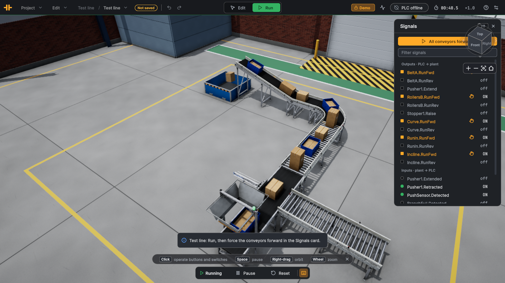

# Test line

Level: basic. The first exercise: a belt, a pusher, a stopper and a few light barriers.

## The plant

Emitter → belt A (pusher to a gravity branch on the left side) → driven rollers with a stopper between two light barriers
→ 90° curve → run-in belt → 18° incline → remover. The emitter puts a small carton, a tote and a tall carton on belt A in
turn, every 2.5 s, whenever the place under it is free.

## Goal

Divert every second load onto the gravity branch, and let loads pass the stopper one at a time with a gap between them.

## I/O list

**Inputs (plant → PLC)**

| Address | PLC tag | Type | Meaning |
|---|---|---|---|
| `%I0.0` | `PushSensor_Detected` | Bool | Light barrier in front of the pusher (belt A) · latched |
| `%I0.1` | `BranchFull_Detected` | Bool | Light barrier: gravity branch full · latched |
| `%I0.2` | `StopperIn_Detected` | Bool | Light barrier in front of the stopper (rollers B) · latched |
| `%I0.3` | `StopperOut_Detected` | Bool | Light barrier just behind the stopper · latched |
| `%I0.4` | `Pusher1_Retracted` | Bool | Pusher end position retracted |
| `%I0.5` | `Pusher1_Extended` | Bool | Pusher end position extended |
| `%I0.6` | `Stopper1_IsUp` | Bool | Stopper blade up (holding) |
| `%I0.7` | `Stopper1_IsDown` | Bool | Stopper blade down (passing) |

**Outputs (PLC → plant)**

| Address | PLC tag | Type | Meaning |
|---|---|---|---|
| `%Q0.0` | `BeltA_RunFwd` | Bool | Belt A forward |
| `%Q0.1` | `BeltA_RunRev` | Bool | Belt A reverse |
| `%Q0.2` | `RollersB_RunFwd` | Bool | Driven rollers B forward |
| `%Q0.3` | `RollersB_RunRev` | Bool | Driven rollers B reverse |
| `%Q0.4` | `Curve_RunFwd` | Bool | 90° curve forward |
| `%Q0.5` | `Curve_RunRev` | Bool | 90° curve reverse |
| `%Q0.6` | `RunIn_RunFwd` | Bool | Run-in belt forward |
| `%Q0.7` | `RunIn_RunRev` | Bool | Run-in belt reverse |
| `%Q1.0` | `Incline_RunFwd` | Bool | Incline belt forward |
| `%Q1.1` | `Incline_RunRev` | Bool | Incline belt reverse |
| `%Q1.2` | `Pusher1_Extend` | Bool | Pusher extend (single-acting valve: 0 = retract) |
| `%Q1.3` | `Stopper1_Raise` | Bool | Stopper raise (1 = hold loads, 0 = let pass) |

Heartbeat word to the PLC: `%IW2` (counts up every exchange).

## Connect the PLC

1. In TIA Portal, import the tag table [TestLine_PLCTags.xlsx](TestLine_PLCTags.xlsx) (PLC tags ▸ Import) into an S7-1500 (or S7-1200) project and download it
   to PLCSIM Advanced or the CPU. Allow PUT/GET access (Protection & Security ▸ Connection mechanisms).
2. In LineRig, open the sample (File ▸ Open sample…), switch to Run, click the **PLC** pill at the top right, enter the
   CPU's address and connect. The app uses this sample's mapping (`Resources/Plc/TestLine.plcmap.json`).
3. While the PLC is connected it owns every output; the demo program is off. Forcing an output in the Signals card still
   overrides the PLC, as in a real CPU.

"Latched" inputs hold a short pulse (a photo-eye interrupted for one 8 ms step) until one exchange has sent it, so a 20 ms
PLC cycle never misses it. Signals are named `<device>.<signal>` in the app and `<device>_<signal>` in TIA Portal.

## Suggested steps

1. Run all conveyors: `BeltA_RunFwd`, `RollersB_RunFwd`, `Curve_RunFwd`, `RunIn_RunFwd`, `Incline_RunFwd`.
2. Stopper: raise it (`Stopper1_Raise`) and lower it for 0.8 s whenever `StopperIn_Detected` sees a load waiting. Raise it again
   as soon as `StopperOut_Detected` sees the load pass, so the blade comes up in the gap.
3. Pusher: count the loads at `PushSensor_Detected`. For every second one stop belt A for 0.3 s, extend the pusher
   (`Pusher1_Extend`) until `Pusher1_Extended`, retract until `Pusher1_Retracted`, then restart belt A.
4. Do not push while `BranchFull_Detected` reports the branch full.

## Expected behaviour

Every second load ends up on the gravity branch; the others pass the stopper singly and climb the incline into the remover.
A full branch makes the line pass every load on.

## Without a PLC

No demo program: in Run, the Signals card opens; **All conveyors forward** forces every `RunFwd` output and the loads run
straight through to the remover. Click an output in the card to force it (the pusher, the stopper) by hand.
